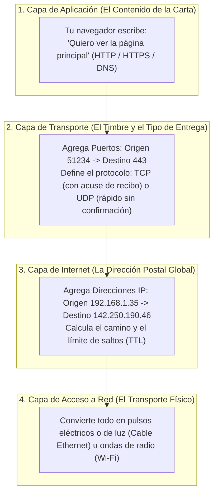
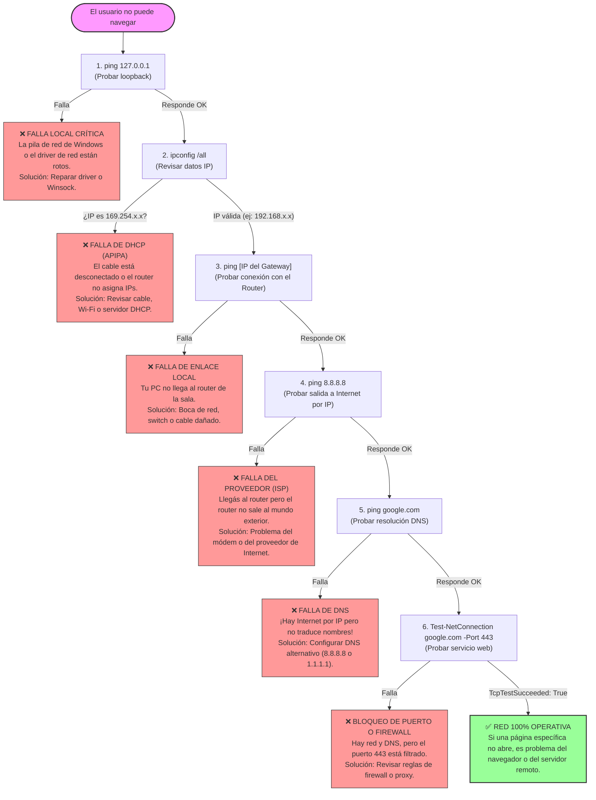

# Manual Teórico de Cátedra: Redes TCP/IP, DNS y Sockets en Windows 11
## Laboratorio de Sistemas Operativos (LSO) — 4.º Año
### Tecnicatura en Informática Personal y Profesional (Res. 3828/09)
### Módulo 4: Redes, Recursos Compartidos y Seguridad — Clase 1

---

## 🎯 Fundamentación: ¿Por qué el Sistema Operativo gestiona la red?

Hasta ahora en el año aprendimos cómo el Sistema Operativo administra la **CPU** (creando procesos con sus PIDs), la **Memoria RAM** (aislando a cada programa con memoria virtual para que no se pisen) y el **Disco** (con particiones y permisos NTFS).

Pero una computadora aislada hoy en día casi no sirve: necesita comunicarse con otras máquinas del laboratorio, servidores en la nube y sitios web.

Aquí surge una pregunta técnica fundamental:  
> **¿Google Chrome o Spotify tienen permiso para controlar directamente la placa de red física y enviar señales eléctricas por el cable?**

**La respuesta es un rotundo NO.** Ninguna aplicación de usuario (*Modo Usuario / Ring 3*) toca el hardware de red. Si pudieran hacerlo, un virus podría espiar las claves de todas las demás aplicaciones. 

El Sistema Operativo actúa como el **gran administrador y aduana**:
1. Tu navegador le pide al Kernel de Windows: *"Por favor, enviá este mensaje a tal servidor"*.
2. El Kernel de Windows (`tcpip.sys` en *Modo Kernel / Ring 0*) toma el mensaje, lo empaqueta con las normas internacionales de red, le pega las etiquetas de seguridad y se lo entrega al controlador (*driver*) de la placa de red.

---

## 1. La Gran Metáfora: La Ciudad, el Edificio y el Correo Postal

Para entender las redes sin marearse con tecnicismos, imaginá que Internet es una **red postal de cartas gigantesca**:

```
+---------------------------------------------------------------------------------+
|                                LA ANALOGÍA POSTAL                                |
+---------------------------------------+-----------------------------------------+
| Concepto de Red                       | Equivalente en el Mundo Real            |
+---------------------------------------+-----------------------------------------+
| Dirección MAC (Capa 2 - Enlace)       | La matrícula o chasis grabado del auto. |
| Dirección IP (Capa 3 - Internet)      | La dirección del edificio (Calle y N.º) |
| Puerto TCP/UDP (Capa 4 - Transporte)  | El número de departamento o timbre.     |
| Socket de Red (IP + Puerto)           | El sobre con remitente y destinatario.  |
| Proceso en Ejecución (PID)            | La persona (inquilino) que atiende.     |
+---------------------------------------+-----------------------------------------+
```

### ¿Por qué no alcanza con la dirección IP sola?
Imaginá que un cartero llega a un edificio de 50 departamentos y la carta solo dice *"Calle Falsa 123"*, pero no aclara a qué departamento va. El cartero no sabría a qué timbre tocar.

En tu computadora pasa exactamente lo mismo: tu máquina tiene **una sola dirección IP**, pero al mismo tiempo tenés abierto Discord, una pestaña de YouTube, Steam descargando un juego y WhatsApp Web.  
* Cuando llega un paquete de datos desde Internet a tu placa de red (al edificio), ¿cómo sabe Windows si ese paquete es un mensaje de WhatsApp o un fotograma de YouTube?  
* **Por el número de Puerto.** WhatsApp escucha en un timbre, YouTube en otro y Steam en otro. El **Puerto** dirige el dato al **Proceso (PID)** correcto.

---

## 2. El Modelo TCP/IP: El Viaje de una Carta (de Chrome al Cable)

Cuando navegás en la web, la información no viaja en un solo bloque gigante. Se divide en paquetes pequeños y atraviesa **4 capas lógicas**. Cada capa hace un trabajo específico y le pega una "etiqueta" (*encabezado*) al paquete:



### La regla de oro del técnico:
> Las capas se leen y se diagnostican **de abajo hacia arriba**. Si el cable está roto o desenchufado (Capa 1/4), es imposible que funcione el direccionamiento IP (Capa 3), y mucho menos la página web (Capa 4).

---

## 3. Direccionamiento IPv4 Explicado Fácil

Una dirección IPv4 se escribe como 4 números separados por puntos (por ejemplo, `192.168.1.35`). Para que una PC pueda comunicarse en una red, necesita **4 datos fundamentales**:

```
[ Dirección IPv4 ] ---------> Tu número identificatorio en la red local.
[ Máscara de Subred ] ------> La línea divisoria: qué parte es tu barrio y qué parte es tu casa.
[ Puerta de Enlace ] -------> El Router: la puerta de salida para hablar con el exterior.
[ Servidores DNS ] ---------> La libreta de contactos que traduce nombres a números.
```

### 1. La Puerta de Enlace Predeterminada (*Gateway*)
Es la dirección IP del **Router** de tu red local. 
* Si querés enviarle un archivo a la PC que está al lado tuyo en el laboratorio, el mensaje viaja directo sin pasar por el router.
* Pero si querés comunicarte con un servidor en Japón o con `google.com`, tu PC no sabe cómo llegar a Japón: simplemente le entrega el paquete a la **Puerta de Enlace** y le dice: *"Tomá, encargate vos de sacarlo a Internet"*.

### 2. El Servidor DNS: La Agenda de Contactos
Las computadoras solo entienden números IP (`142.250.190.46`), pero los seres humanos recordamos nombres (`google.com`).  
El **DNS (Domain Name System)** es la agenda de tu teléfono:
* Vos no marcás de memoria el número de 10 dígitos de tu amigo; buscás *"Lucas"* y el teléfono marca solo.
* En Internet, cuando escribís `google.com`, Windows le pregunta al servidor DNS: *"¿Qué IP tiene google.com?"*. El DNS responde *"Tiene la 142.250.190.46"*, y recién ahí tu máquina se conecta.

> [!TIP]
> **Caché DNS:** Para no andar preguntándole al servidor DNS a cada segundo la misma cosa, Windows guarda las respuestas recientes en su memoria local. Podés verla con `ipconfig /displaydns` y vaciarla con `ipconfig /flushdns`.

---

## 4. Las Tres Direcciones "Raras" que Todo Técnico Debe Conocer

En la consola de comandos te vas a cruzar con direcciones especiales que tienen un significado clínico concreto:

### A. La dirección `127.0.0.1` (Loopback): "Hablarte al espejo"
* Es la dirección de **tu propia máquina**.
* Cuando ejecutás `ping 127.0.0.1`, los paquetes no salen al cable ni a la antena Wi-Fi; bajan hasta la pila de red del Kernel y vuelven a subir.
* **¿Para qué sirve?** Si te hacés ping a vos mismo y responde, sabés con total certeza que el software de red de Windows (`tcpip.sys`) y tu sistema operativo están funcionando bien. Es como tomarte el pulso para ver si estás vivo.

### B. Las IPs Privadas (`192.168.x.x`, `10.x.x.x`): "Los nombres de entrecasa"
* En tu casa, tu mamá te llama por tu nombre de pila (*"Martín"*), pero para el Estado sos un DNI único.
* Las IPs privadas solo tienen validez adentro de tu casa o del colegio. Miles de casas en el mundo usan al mismo tiempo la IP `192.168.1.100`. Para salir a Internet, el router las traduce a una única **IP Pública** mediante una técnica llamada **NAT**.

### C. La dirección `169.254.x.x` (APIPA): "El número de la fila cuando no hay nadie en la ventanilla"
* Normalmente, cuando enchufás la PC, un servicio llamado **DHCP** (que corre en el router) te asigna automáticamente tu IP, tu máscara y tu DNS.
* Si enchufás el cable pero el router está apagado, roto o el cable no hace buen contacto, la PC pide auxilio: *"¡Hola! ¿Hay algún servidor DHCP que me dé una IP?"*. Nadie responde.
* Tras unos segundos de silencio, Windows no se queda con las manos vacías: se autoasigna una IP de emergencia que siempre empieza con **`169.254.`**.
* **Diagnóstico instantáneo:** Si ves `169.254.x.x`, **DHCP falló**. No busques problemas en Google ni en el navegador: la PC no tiene comunicación con el router.

---

## 5. Herramientas de Sondeo: Ping, TTL y Tracert

### ¿Cómo funciona el `ping`?
Envía un pequeño paquete de saludo llamado **ICMP Echo Request** y espera la respuesta (**Echo Reply**). Mide dos cosas:
1. **Conectividad:** Si el otro equipo está encendido y accesible.
2. **Latencia:** Cuántos milisegundos tarda la señal en ir y volver.

### El misterio del campo `TTL` (*Time To Live*)
¿Te imaginás qué pasaría si un paquete de datos busca una dirección que no existe y los routers se lo van pasando en círculos eternamente? La red mundial colapsaría llena de paquetes perdidos.

Para evitar esto, cada paquete nace con un contador de vidas llamado **TTL** (por ejemplo, 128 o 64).  
* Cada vez que el paquete atraviesa un router intermedio, ese router le resta 1 al TTL: `128 -> 127 -> 126...`.
* Si el TTL llega a `0`, el router descarta el paquete y avisa: *"Se agotó el tiempo de vida"*.

### ¿Cómo hace `tracert` para dibujar la ruta del paquete?
El comando `tracert` aprovecha el TTL de una manera brillante:
1. Manda un primer paquete con `TTL = 1`. El primer router (tu gateway) le resta 1, llega a 0, descarta el paquete y responde diciendo: *"Hola, soy el router 192.168.1.1 y acá murió tu paquete"*. ¡Listo! Ya sabemos quién es el primer salto.
2. Manda un segundo paquete con `TTL = 2`. Supera el primer router, llega al segundo, muere ahí y ese segundo router se identifica.
3. Repite esto sucesivamente hasta llegar al destino final, dibujando mapa y latencia de cada parada en el camino.

---

## 6. El Portero Eléctrico: Puertos, Sockets y Procesos

Volvamos a la metáfora del edificio. En Windows existen **65.536 puertos posibles** (del 0 al 65535) tanto en TCP como en UDP:

```
[ Puerto 80 ]   ------> Tráfico Web estándar (HTTP sin cifrar)
[ Puerto 443 ]  ------> Tráfico Web seguro y bancario (HTTPS con cifrado SSL/TLS)
[ Puerto 53 ]   ------> Consultas a servidores de nombres (DNS)
[ Puerto 445 ]  ------> Recursos compartidos de archivos en red de Windows (SMB)
[ Puerto 8080 ] ------> Servidores web alternativos o de desarrollo
```

### Los Estados TCP que vas a ver en la terminal (`netstat`)

```
   [ LISTENING ]               [ ESTABLISHED ]                [ TIME_WAIT ]
        🚪                          🤝                            ⏳
El proceso está sentado     Hay una conexión activa.       La conexión ya terminó.
esperando que alguien       Dos máquinas están hablando    El puerto espera unos
toque el timbre en ese      y transfiriendo datos          segundos antes de quedar
puerto (actúa de servidor). activamente.                   libre otra vez.
```

### ¿Qué es un Socket?
Un **Socket** es la unión inseparable de:
$$\text{Socket} = \text{Dirección IP} : \text{Puerto} : \text{Protocolo}$$
*Ejemplo:* `192.168.1.35:49820:TCP`  
Una conexión en Internet se produce cuando el **Socket de tu PC** se conecta con el **Socket del Servidor remoto**.

### La Misión Detective: Vincular el Puerto con el PID
En una consola con `netstat -ano`, cada socket muestra una columna al final: el **PID** (*Process ID*).
* Si ves el puerto `8080` en estado `LISTENING`, significa que algún programa en tu máquina está escuchando conexiones.
* Mirás su PID (por ejemplo, `4812`).
* Vas al Administrador de Tareas (pestaña Detalles) o ejecutás en PowerShell: `Get-Process -Id 4812`.
* **¡Atrapaste al culpable!** Ahora sabés exactamente qué ejecutable abrió ese puerto. En ciberseguridad, así es como se detectan troyanos y puertas traseras.

---

## 7. Árbol de Decisión del Técnico: "No Hay Internet"

Cuando un usuario te llama diciendo *"Se cayó internet"*, un técnico profesional no prueba cosas al azar ni reinicia la PC a ciegas. Sigue este árbol de descarte lógico por capas:



---

## 8. Resumen de Comandos Clínicos para la Terminal

| Qué querés averiguar | En Símbolo del Sistema (CMD) | En PowerShell | Para qué se usa en la práctica |
| :--- | :--- | :--- | :--- |
| **Mi configuración completa** | `ipconfig /all` | `Get-NetIPConfiguration` | Ver tu IP, máscara, gateway, MAC y servidores DNS. |
| **Conectividad básica** | `ping [destino]` | `Test-Connection [destino]` | Medir si el otro equipo responde y la latencia. |
| **Traducir un nombre a IP** | `nslookup [dominio]` | `Resolve-DnsName [dominio]` | Probar si el servidor DNS está respondiendo bien. |
| **Ver la memoria de nombres** | `ipconfig /displaydns` | `Get-DnsClientCache` | Ver las páginas que Windows ya resolvió recientemente. |
| **Camino que hace el paquete** | `tracert [destino]` | `Test-NetConnection -TraceRoute` | Ver todos los routers intermedios y dónde se corta la señal. |
| **Probar un puerto remoto** | *(No tiene nativo simple)* | `Test-NetConnection [IP] -Port [N]` | Saber si un servicio remoto (como web en 443) está escuchando. |
| **Ver puertos abiertos y PIDs**| `netstat -ano` | `Get-NetTCPConnection` | Auditar qué puertos están en `LISTENING` y quién es el dueño. |
| **Identificar proceso por PID**| `tasklist /fi "PID eq [N]"`| `Get-Process -Id [N]` | Saber qué programa exacto abrió una conexión sospechosa. |

---

### 💡 Consejo Final para el Laboratorio:
No intentes memorizar comandos de memoria sin sentido. Cada vez que escribas un comando en la pantalla negra, pensá:  
> **"¿Qué le estoy preguntando al Sistema Operativo? ¿A qué capa pertenece este dato?"**  
Esa es la diferencia entre un operador común y un verdadero técnico en informática.
