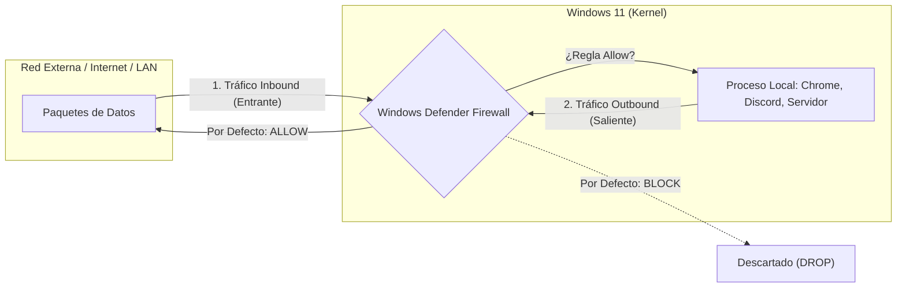
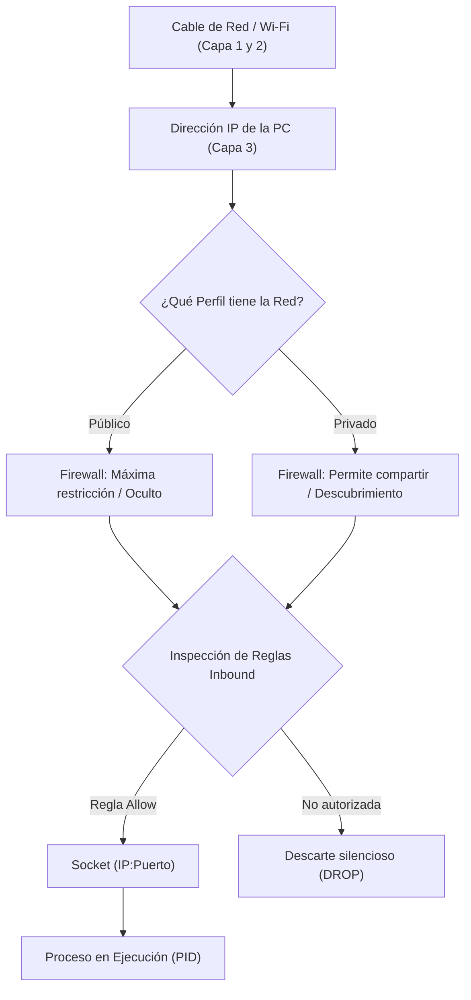

# Manual Teórico de Cátedra: Perfiles de Red y Windows Defender Firewall
## Laboratorio de Sistemas Operativos (LSO) — 4.º Año
### Tecnicatura en Informática Personal y Profesional (Res. 3828/09)
### Módulo 4: Redes, Recursos Compartidos y Seguridad — Clase 2

---

## 🎯 Fundamentación: Del Socket Abierto a la Seguridad Perimetral

En la clase anterior aprendimos que un proceso (como un navegador, un juego o un servidor web) puede pedirle al Sistema Operativo abrir un **puerto TCP/UDP** y quedarse escuchando (`LISTENING`). Vimos que la combinación de **IP + Puerto** forma un **Socket**.

Pero esto plantea una alarma inmediata de ciberseguridad:
> *Si cualquier programa puede abrir un puerto en nuestra computadora, ¿cualquier otra máquina de la red local o de Internet puede enviarnos datos o conectarse sin control?*

La respuesta en los sistemas operativos modernos es **NO**. Entre la placa de red física y los sockets de los procesos existe un guardián implacable administrado por el Kernel de Windows: el **Windows Defender Firewall** (Cortafuegos del Sistema Operativo).

---

## 1. La Gran Metáfora: El Guardia de Seguridad en la Entrada del Edificio

Siguiendo nuestra analogía del edificio y el correo postal:

```
+-----------------------------------------------------------------------------------------+
|                                    LA ANALOGÍA POSTAL                                   |
+------------------------------------+----------------------------------------------------+
| Concepto de Red y Seguridad        | Equivalente en el Mundo Real                       |
+------------------------------------+----------------------------------------------------+
| Dirección IP                       | La dirección de la calle del edificio.            |
| Puerto TCP/UDP                     | El timbre de cada departamento.                    |
| Proceso (PID)                      | El inquilino que vive adentro y atiende.           |
| Windows Defender Firewall          | La garita de seguridad / portería del edificio.   |
| Regla Inbound (Entrante)           | La lista de visitas que tienen permiso de entrar.  |
| Regla Outbound (Saliente)          | El permiso de los vecinos para salir a la calle.   |
| Perfil Público vs. Privado         | ¿El edificio está en una peatonal o en un barrio?  |
+------------------------------------+----------------------------------------------------+
```

### ¿Cómo actúa el Firewall?
Cuando llega una carta o un visitante desde la red exterior:
1. El paquete golpea la puerta del sistema operativo.
2. El **Firewall inspecciona la etiqueta**: ¿De qué IP viene? ¿A qué puerto (timbre) se dirige? ¿Qué protocolo usa?
3. El Firewall consulta su **Libro de Reglas**:
   * Si hay una regla explícita que dice **PERMITIR (Allow)**, el paquete pasa y llega al proceso.
   * Si no hay regla que lo autorice, el paquete es **DESCARTADO SILENCIOSAMENTE (Drop / Block)**. El inquilino (proceso) ni siquiera se entera de que alguien tocó el timbre.

---

## 2. Direcciones de Tráfico: Inbound (Entrada) vs. Outbound (Salida)

Un firewall de host (*Host-based Firewall*) categoriza todo el tráfico en dos sentidos:



### Reglas Inbound (Tráfico Entrante)
* Son los paquetes que **otra máquina inicia** hacia la nuestra (alguien llama a nuestra IP:puerto).
* **Política por defecto en Windows:** **BLOQUEAR (Block)**.
* Si instalás un servidor web (puerto 80/443), una base de datos MySQL (puerto 3306) o compartís una carpeta (puerto SMB 445), nadie podrá conectarse a menos que crees una **Regla de Entrada** que abra ese puerto.

### Reglas Outbound (Tráfico Saliente)
* Son las conexiones que **nuestros propios programas inician** hacia el exterior (cuando abrís `google.com` o descargás de Steam).
* **Política por defecto en Windows:** **PERMITIR (Allow)**.
* Como confiamos en el usuario que usa la máquina, Windows deja salir prácticamente todo.

### 💡 Concepto Clave: Firewall con Inspección de Estado (*Stateful Firewall*)
Una duda típica de los estudiantes es:  
> *"Si las reglas Inbound bloquean la entrada por defecto... ¿cómo hace la página de Google para entrar a mi máquina cuando yo navego?"*

La respuesta es que Windows Firewall es **con estado (Stateful)**:
* Cuando Chrome envía una petición saliente (*Outbound*) al servidor de Google, el Firewall anota en una tabla temporal: *"Chrome inició una conversación con la IP X en el puerto 443"*.
* Cuando los datos de Google vuelven a tu máquina (*Inbound*), el Firewall reconoce que **son la respuesta legítima a una conexión saliente previa** y los deja pasar automáticamente.
* Solo se bloquean las conexiones entrantes que **nadie desde adentro pidió**.

---

## 3. Los 3 Perfiles de Red en Windows 11

Windows clasifica cada placa de red activa en uno de tres **Perfiles de Ubicación de Red**. El comportamiento del firewall cambia radicalmente según el perfil:

| Característica | Perfil Público (*Public*) 🌐 | Perfil Privado (*Private*) 🏠 | Perfil de Dominio (*Domain*) 🏢 |
| :--- | :--- | :--- | :--- |
| **Escenario típico** | Aeropuertos, cafeterías, Wi-Fi público, redes desconocidas. | Red de tu casa, red del laboratorio escolar protegida. | Red corporativa unida a un Dominio Active Directory. |
| **Nivel de confianza** | **Cero confianza.** | Confianza media / alta. | Administrado centralmente por el Administrador de Red. |
| **Detección de redes** | **Desactivada.** Tu PC es invisible para los demás. | **Activada.** Otras PC pueden ver tu equipo en la red. | Controlada por directivas de grupo (GPO). |
| **Compartir archivos e impresoras** | **Bloqueado terminantemente.** | **Permitido** (según configuración de carpetas). | Permitido para recursos de la empresa. |
| **Respuesta a `ping` (ICMP)** | Bloqueada. | Bloqueada por defecto (se puede habilitar). | Habitualmente habilitada para monitoreo. |

> ⚠️ **Regla de Oro del Técnico:**  
> Si te conectás a una red Wi-Fi en un bar o plaza y Windows te pregunta *"¿Deseas permitir que otros equipos de esta red encuentren tu PC?"*, responder **SÍ** pone tu perfil en **Privado** y abre las puertas del firewall. Responder **NO** activa el perfil **Público**, la opción más segura.

---

## 4. El Gran Misterio de Laboratorio: ¿Por qué falla el `ping` entre compañeros?

En el laboratorio de la escuela es muy común que un alumno intente hacer:
```cmd
ping 192.168.1.45 (la IP del compañero de banco)
```
Y obtenga:
```text
Tiempo de espera agotado para esta solicitud. (Request timed out)
```

Muchos estudiantes creen erróneamente: *"El cable está roto"* o *"La red no anda"*.  
**La realidad:** El cable funciona perfecto. El paquete ICMP llegó a la placa de red del compañero, pero el **Windows Defender Firewall lo frenó en seco** y lo descartó sin avisar.

### La Regla Responsable: ICMPv4-In
El protocolo de `ping` se llama **ICMP** (Protocolo de Mensajes de Control de Internet).
En Windows 11, la regla predefinida:
```text
Compartir archivos e impresoras (solicitud de eco: ICMPv4-In)
```
Viene **deshabilitada por defecto** en el perfil Público (y muchas veces en el Privado) para evitar que atacantes escaneen la red descubriendo qué computadoras están encendidas (*Network Reconnaissance*).

---

## 5. Auditoría del Firewall con PowerShell (Comandos para Técnicos)

En entornos corporativos o educativos congelados (como nuestro laboratorio con Deep Freeze), los técnicos auditamos la seguridad usando la consola sin necesidad de abrir interfaces lentas.

### 1. Ver qué perfil tiene asignado nuestra conexión actual
```powershell
Get-NetConnectionProfile
```
*Muestra el nombre de la red, la interfaz y si está categorizada como `Public` o `Private`.*

### 2. Auditar el estado general de los perfiles del Firewall
```powershell
Get-NetFirewallProfile | Select-Object Name, Enabled, DefaultInboundAction, DefaultOutboundAction
```
*Muestra si el firewall está activo en Dominio, Privado y Público, y cuál es la acción por defecto.*

### 3. Buscar si una regla específica está activa
```powershell
# Buscar reglas relacionadas con PING (ICMPv4)
Get-NetFirewallRule -DisplayName "*eco*" | Select-Object DisplayName, Enabled, Direction, Action

# Buscar reglas relacionadas con el Escritorio Remoto (RDP)
Get-NetFirewallRule -DisplayGroup "Escritorio remoto" | Select-Object DisplayName, Enabled, Profile
```

### 4. Probar conectividad hacia un puerto específico (El sustituto moderno de telnet)
```powershell
Test-NetConnection -ComputerName 127.0.0.1 -Port 8080
```
*Si devuelve `TcpTestSucceeded: True`, el puerto está abierto y el firewall permite la conexión.*

---

## 6. Síntesis Conceptual del Módulo



Con estos conceptos claros, pasamos a la práctica en el laboratorio para auditar nuestras terminales, comprobar los bloqueos reales entre puestos y analizar escenarios de ataque.
