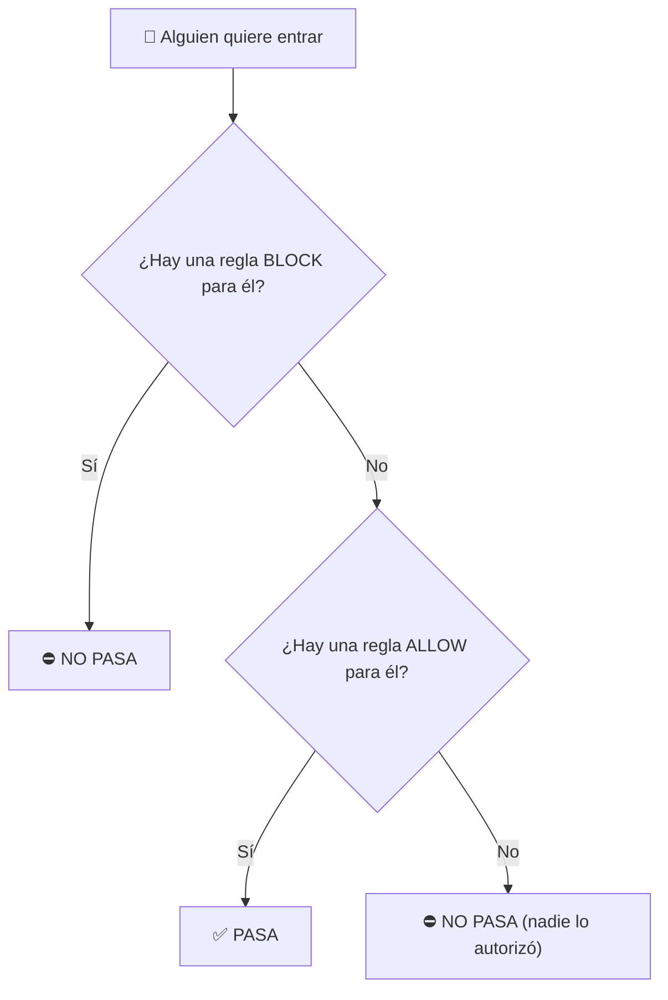

# Manual Teórico: El Portero y su Lista — Reglas del Firewall
## Laboratorio de Sistemas Operativos (LSO) — 4.º Año
### Módulo 4: Redes, Recursos Compartidos y Seguridad — Clase 3

---

## 🎯 ¿De qué se trata hoy?

¿Te acordás del misterio de la clase pasada? El servidor de prueba de tu compañero estaba **encendido** (escuchando en el puerto `8080`), pero cuando quisiste conectarte desde tu PC, la respuesta fue `False`. 🤔

**¿Quién tuvo la culpa?** El **firewall de Windows**. Su forma de trabajar por defecto es simple:

> 🚪 **Si nadie avisó que podés entrar, no entrás.**

Hoy vamos a aprender a **escribir esos avisos**. Cada aviso se llama **regla**. Y vamos a aprender a escribirlos **bien**, porque una regla mal hecha puede dejar la puerta abierta para cualquiera.

---

## 1. El portero y su lista 🧍‍♂️📋

En la Clase 2 dijimos que el firewall es como el **portero de un edificio**:

| En el edificio | En la computadora |
| :--- | :--- |
| 🏢 La dirección del edificio | La **dirección IP** de la PC |
| 🔔 El timbre de cada departamento | El **puerto** (ej.: `8080`) |
| 🧑 El vecino que atiende el timbre | El **programa** que está escuchando |
| 🧍‍♂️ El portero | El **firewall** |
| 📋 La lista del portero | Las **reglas** del firewall |

El portero **no adivina**: mira su lista. Cada renglón de la lista es **una regla**.

---

## 2. Las 5 preguntas de una regla 📝

Para escribir una regla tenés que responder estas 5 preguntas. Así armás la **ficha** de la regla:

| # | Pregunta del portero | Cómo se llama en Windows | Respuestas posibles |
| :-: | :--- | :--- | :--- |
| 1 | ¿La persona **entra o sale**? | **Dirección** | `Inbound` (entra) · `Outbound` (sale) |
| 2 | ¿La **dejo pasar o no**? | **Acción** | `Allow` (permitir) · `Block` (bloquear) |
| 3 | ¿A qué **timbre** va? | **Puerto** | Un número: `80`, `443`, `8080`... |
| 4 | ¿**Quién** es? ¿De dónde viene? | **IP remota** | Cualquiera · Las PC del aula · Una PC puntual |
| 5 | ¿Qué **vecino** lo pidió? | **Programa** *(opcional)* | `chrome.exe`, `curl.exe`... |

### 2.1 ¿Entra o sale? (Dirección)
* ⬇️ **Inbound (entrada):** otra PC quiere conectarse **a la tuya**. Por defecto: **se bloquea**.
* ⬆️ **Outbound (salida):** un programa **tuyo** quiere conectarse afuera (ej.: Chrome abriendo YouTube). Por defecto: **se permite**.

> 💡 Cuando abrís una página, la respuesta de la página entra sola. El firewall se acuerda de que **vos la pediste**. Solo frena lo que llega **sin que nadie lo haya pedido**.

### 2.2 ¿Lo dejo pasar? (Acción)
* ✅ **Allow:** pasa.
* ⛔ **Block:** no pasa. El firewall lo descarta **sin avisar**: el que llamó se queda esperando.

### 2.3 ¿A qué timbre va? (Puerto)
Cada servicio tiene su "timbre" conocido:

| Puerto | ¿Qué servicio es? |
| :-: | :--- |
| `80` | Páginas web |
| `443` | Páginas web seguras (con candadito 🔒) |
| `445` | Carpetas compartidas de Windows |
| `3389` | Escritorio Remoto |
| `8080` | Nuestro servidor de prueba de la clase |

* Los servicios como la web usan el **protocolo TCP**. Por eso en las reglas con puerto vas a ver `TCP`.
* 🏓 **El ping es especial:** no usa puerto. En la regla se elige el tipo **`ICMPv4`** (el "idioma" del ping).
* En una regla de **salida**, el puerto es el **timbre de la otra PC** (ej.: bloquear que tus programas toquen el timbre `23` de cualquier servidor).

### 2.4 ¿Quién es? (IP remota)
Esta es la pregunta que **más importa para la seguridad**:

| Opción | ¿Quién puede? | ¿Qué tan seguro? |
| :--- | :--- | :-: |
| **Cualquiera** (`Any`) | Cualquier PC del mundo | 🔴 Peligroso |
| **Las PC del aula** (`LocalSubnet`) | Solo las PC de tu misma red | 🟡 Bien |
| **Una PC puntual** (ej.: `192.168.10.30`) | Solo esa compu | 🟢 Muy seguro |

> 💡 `LocalSubnet` quiere decir "mi red local". Windows calcula solo cuáles son las PC de tu red, así que no hace falta escribir todas las IP.

### 2.5 ¿Qué programa? (opcional)
Sirve para apuntar a **un solo programa**. Ejemplo: bloquear `curl.exe` sin molestar a Chrome. Si bloquearas el puerto `443`, ¡te quedarías sin Chrome también! 😅

---

## 3. Las 3 reglas de oro ⭐

### ⭐ 1. "Lo que no escribís, vale para **todos**"
Si en la ficha dejás una pregunta sin responder, Windows entiende **"cualquiera"**.
* Sin puerto → **todos** los puertos.
* Sin IP remota → **cualquier** PC del mundo.

👉 Una regla **corta** es una regla **muy abierta**.

### ⭐ 2. "Si hay un SÍ y un NO, **gana el NO**"
Imaginá la lista de un cumple 🎂:
* Renglón 1: *"Pueden entrar todos los del curso"* ✅
* Renglón 2: *"Juan NO entra"* ⛔

Juan es del curso, pero **no entra**: el **NO** le gana al **SÍ**.

En el firewall pasa lo mismo: si una regla **Block** y una regla **Allow** coinciden, **gana Block**. No importa cuál se creó primero.

> 🔗 **Ya lo viste en el Módulo 2:** en los permisos NTFS, un **Denegar** le gana a un **Permitir**. ¡Es la misma idea!

**¿Y si quiero abrirle a todos menos a uno?** Hacés **dos reglas**:
1. ✅ Una que **permite** a todo el aula.
2. ⛔ Otra que **bloquea** solo a esa PC.

### ⭐ 3. "Abrí **lo justo**"
Esto se llama **mínimo privilegio**: dar solo el permiso necesario, ni uno más.
* 🟢 Mejor: **una PC puntual**
* 🟡 Bien: **las PC del aula**
* 🔴 Evitar: **cualquiera**

Y nunca, nunca: *"Permitir todo lo que entra, desde cualquiera"*. Eso es lo mismo que **apagar el firewall**. 💀

---

## 4. ¿Cómo decide el portero? 🤔

Cuando alguien quiere **entrar** a tu PC, el firewall sigue estos pasos:



1. ¿Hay algún **Block** que coincida? → **No pasa**.
2. ¿Hay algún **Allow** que coincida? → **Pasa**.
3. ¿No hay ninguna regla? → **No pasa** (en la salida, al revés: pasa).

---

## 5. De la ficha al comando 💻

> ⚠️ **Crear reglas necesita ser administrador.** En el laboratorio las crea **el profe** en su PC. Ustedes las **leen**, las **prueban** y las arman en el **simulador**.

### 5.1 Un ejemplo, paso a paso
**Pedido:** *"Abrir el puerto 8080 solo para las PC del aula."*

**Ficha:**

| Dirección | Acción | Puerto | IP remota | Programa |
| :-: | :-: | :-: | :-: | :-: |
| Entra | Permitir | TCP 8080 | Las PC del aula | — |

**Comando en PowerShell:**
```powershell
New-NetFirewallRule -DisplayName "Web 8080 aula" -Direction Inbound -Action Allow -Protocol TCP -LocalPort 8080 -RemoteAddress LocalSubnet
```

**Cómo se lee cada parte:**

| Parte del comando | Qué quiere decir |
| :--- | :--- |
| `New-NetFirewallRule` | "Crear una regla nueva de firewall" |
| `-DisplayName "Web 8080 aula"` | El nombre de la regla (para encontrarla después) |
| `-Direction Inbound` | Pregunta 1: **entra** |
| `-Action Allow` | Pregunta 2: **permitir** |
| `-Protocol TCP -LocalPort 8080` | Pregunta 3: al **timbre 8080** de mi PC |
| `-RemoteAddress LocalSubnet` | Pregunta 4: solo **las PC del aula** |

> 💡 El comando es **la ficha escrita en inglés**. Si sabés armar la ficha, sabés leer el comando.

### 5.2 Otros ejemplos listos para leer

| Pedido | Comando |
| :--- | :--- |
| 🏓 Que el aula me pueda hacer **ping** | `New-NetFirewallRule -DisplayName "Ping aula" -Direction Inbound -Action Allow -Protocol ICMPv4 -RemoteAddress LocalSubnet` |
| ⛔ **Bloquear** a la PC `192.168.10.66` | `New-NetFirewallRule -DisplayName "Bloquear 66" -Direction Inbound -Action Block -RemoteAddress 192.168.10.66` |
| 🚫 Que **curl.exe** no salga a Internet | `New-NetFirewallRule -DisplayName "Sin curl" -Direction Outbound -Action Block -Program "C:\Windows\System32\curl.exe"` |

> 🤓 **Para curiosos:** en CMD existe otro comando que hace lo mismo: `netsh advfirewall firewall add rule name="Web 8080 aula" dir=in action=allow protocol=TCP localport=8080 remoteip=localsubnet`. ¡Fijate que tiene las mismas 5 respuestas!

---

## 6. Espiar las reglas de tu PC (¡sin ser admin!) 🔍

**Mirar** reglas no necesita permisos especiales. Probá en PowerShell:

```powershell
# ¿Cuántas reglas dejan ENTRAR tráfico en mi PC?
(Get-NetFirewallRule -Direction Inbound -Action Allow -Enabled True).Count

# Ver las reglas del ping (nombre, si está activa y qué hace)
Get-NetFirewallRule -DisplayName "*eco*" | Select-Object DisplayName, Enabled, Direction, Action
```

| Acción | ¿Necesita admin? |
| :--- | :-: |
| Ver / listar reglas | ❌ No |
| Crear, cambiar o borrar reglas | ✅ Sí |

---

## 7. Los 3 errores más comunes 🐛

| Error | Ejemplo | ¿Qué pasa? |
| :--- | :--- | :--- |
| **Dirección al revés** | Querías dejar entrar y pusiste `Outbound` | La regla existe, pero cuida la otra puerta. Nadie entra. |
| **Timbre equivocado** | El servidor usa `8080` y abriste el `8081` | La regla nunca se usa. |
| **Abrir de más** | No pusiste IP remota | Entra **cualquiera**, no solo el aula. 😱 |

> 🔧 **Truco del técnico:** siempre probá **las dos caras**: que **entre** quien tiene que entrar (`True`) y que **no entre** quien no tiene que entrar (`False`).

---

## 8. Resumen en 6 frases 🧠

1. El firewall es el **portero**; las **reglas** son su **lista**.
2. Una regla responde 5 preguntas: **¿entra o sale? ¿pasa o no? ¿qué puerto? ¿quién? ¿qué programa?**
3. Lo que entra **sin regla** se **bloquea**; lo que sale sin regla se **permite**.
4. Lo que no escribís vale para **todos**.
5. Si un **Allow** y un **Block** coinciden, **gana Block**.
6. Abrí **lo justo**: mejor una PC que el aula, y mejor el aula que cualquiera.

### 📖 Mini glosario
| Palabra | Significado |
| :--- | :--- |
| **Firewall** | Programa que decide qué conexiones pasan y cuáles no |
| **Regla** | Un renglón de la lista del firewall |
| **Inbound / Outbound** | Entrada / Salida |
| **Allow / Block** | Permitir / Bloquear |
| **Puerto** | El "timbre" de un servicio dentro de la PC |
| **IP remota** | La dirección de la **otra** PC |
| **LocalSubnet** | "Las PC de mi red local" (el aula) |
| **Mínimo privilegio** | Dar solo el permiso necesario |

¡Listo! Ahora vamos al laboratorio: el profe va a crear reglas de verdad y ustedes van a comprobar si funcionan. 🚀
